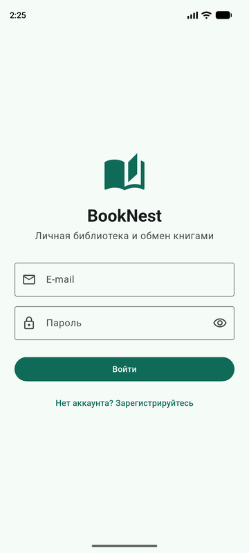
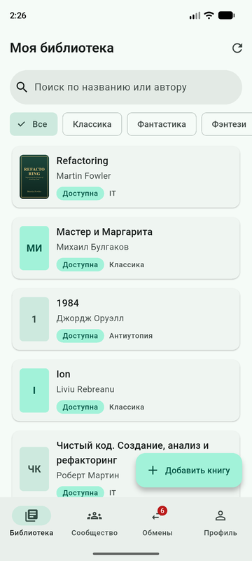
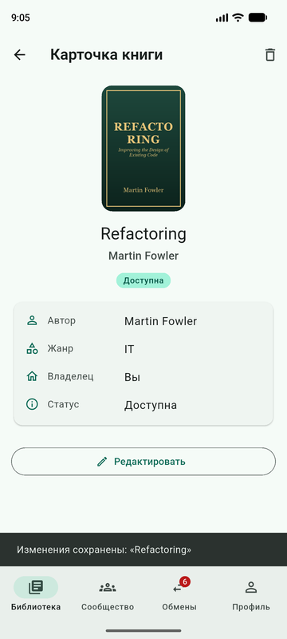
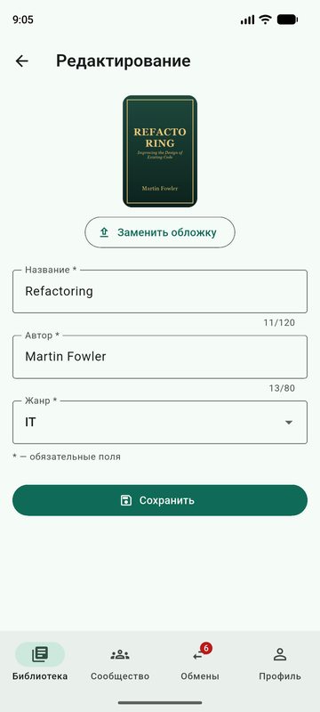
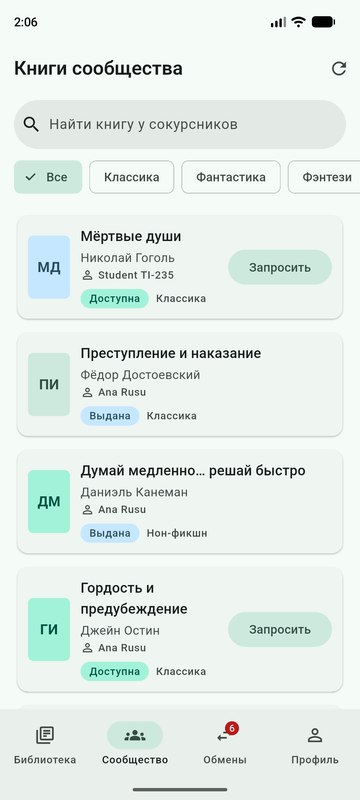
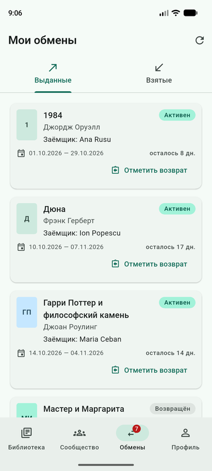
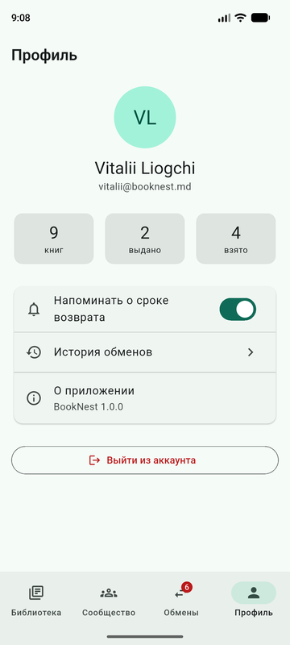
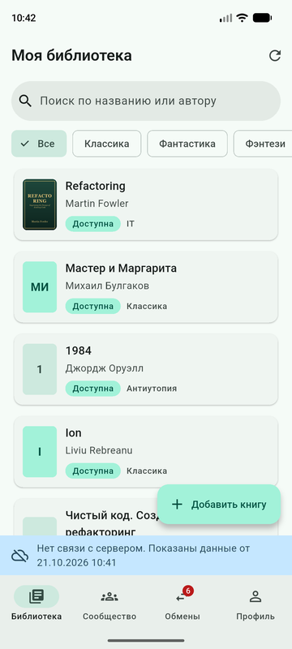
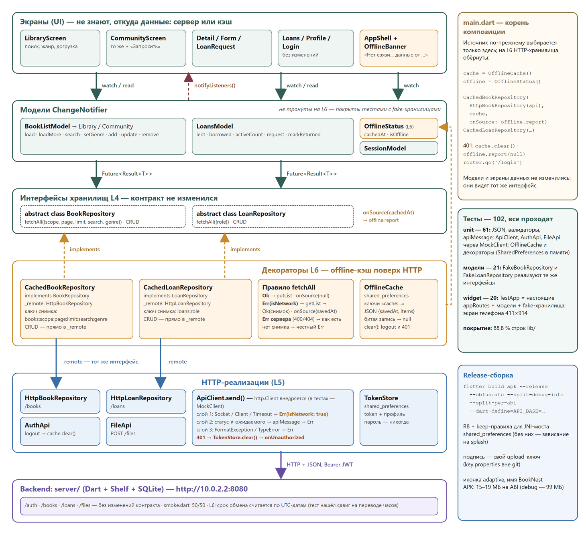

# BookNest — личная библиотека и обмен книгами


Мобильное приложение на Flutter: веди каталог своих книг, смотри, что есть у сокурсников, бери книги на время и отмечай возврат. Своё серверное приложение на Dart, работа без сети на последних сохранённых данных.

Семестровый проект по дисциплине «Программирование мобильных приложений» (PAM), Технический университет Молдовы. Тема каталога — **T5. BookNest**.
Автор: **Liogchi Vitalii**, группа TI-235. Преподаватель: унив. лектор Ionel Antohi.

<p>
  
  
  
  
</p>
<p>
  
  
  
  
</p>

## Возможности

| Экран | Что умеет |
|---|---|
| Вход / регистрация | Валидация формы, вход на сервере (JWT), сессия переживает перезапуск |
| Моя библиотека | Поиск по названию и автору и фильтр по жанру — на сервере, догрузка страниц при прокрутке, удаление свайпом с подтверждением |
| Карточка книги | Обложка, автор, жанр, статус, у кого книга сейчас и до какого числа |
| Форма книги | Создание и редактирование, обязательные поля, загрузка обложки из галереи (`POST /files`) |
| Книги сообщества | Книги других пользователей с владельцем, кнопка «Запросить» |
| Запрос книги | Срок возврата из календаря: в будущем и не дольше 60 дней |
| Мои обмены | Выданные и взятые книги, сроки, просрочки, «Отметить возврат»; число активных обменов — на бейдже вкладки |
| Профиль | Статистика, выход из аккаунта |

**Без сети** приложение показывает последние полученные с сервера списки и баннер «Нет связи с сервером. Показаны данные от …». Ответ сервера с ошибкой (400/404) старыми данными не подменяется.

## Стек

- **Приложение:** Flutter 3.47 / Dart 3.13, Material 3 (вся палитра из одного seed-цвета `#2F5D50`), `go_router` (вкладки через `StatefulShellRoute`), `provider` (ChangeNotifier-модели), `http`, `shared_preferences`, `image_picker`.
- **Сервер:** Dart + `shelf` / `shelf_router`, SQLite (`sqlite3`), JWT HS256. Основа — эталонный backend-шаблон курса, расширенный книгами и обменами.

## Архитектура



- **Экраны** читают модели (`watch` в `build`, `read` в обработчиках) и не знают, откуда данные.
- **Модели** (`BookListModel`, `LoansModel`, `SessionModel`, `OfflineStatus`) держат состояние и триаду «грузится / данные / ошибка». Хранилище получают через конструктор.
- **Интерфейсы хранилищ** `BookRepository` и `LoanRepository` возвращают `Future<Result<T>>`, где `Result` — sealed-класс `Ok` / `Err`. Ожидаемый отказ — это значение, а не исключение.
- **HTTP-реализации** проходят через общий `ApiClient.send` с тремя слоями отказа (сеть, статус ответа, форма тела). Ответ 401 стирает токен и уводит на вход.
- **Декораторы** `CachedBookRepository` и `CachedLoanRepository` реализуют тот же интерфейс поверх HTTP и хранят снимки списков для работы без сети.
- **Корень композиции** `lib/main.dart` — единственное место, где выбирается источник данных. Смена mock → HTTP → HTTP с кэшем не затронула ни одного экрана списков.

## Структура репозитория

```
lib/
  main.dart            корень композиции: хранилища, модели, MultiProvider
  router.dart          карта маршрутов (go_router)
  validators.dart      валидаторы форм
  data/                сущности, Result, интерфейсы и реализации хранилищ, ApiClient, кэш
  models/              ChangeNotifier-модели
  screens/             8 экранов
  widgets/             переиспользуемые виджеты (карточка книги, обложка, баннер offline…)
test/                  102 теста: data/, models/, screens/, widgets/; support/ — fake-хранилища и TestApp
server/                backend: bin/server.dart, lib/ (books.dart, loans.dart…), tool/seed.dart, tool/smoke.dart
tool/make_icon.py      рисует иконку приложения
assets/icon/           исходники иконки
docs/                  скриншоты и диаграмма для этого README
```

## Запуск

Нужны Flutter SDK, Android SDK и эмулятор или телефон.

**1. Сервер**

```bash
cd server
dart pub get
dart run tool/seed.dart      # демо-данные: 5 пользователей, 32 книги, 12 обменов
dart run bin/server.dart     # http://localhost:8080
```

На Windows пакету `sqlite3` нужен `sqlite3.dll` рядом с сервером: с sqlite.org (Precompiled Binaries for Windows, x64) или из установленного Python (`DLLs\sqlite3.dll`). В репозитории его нет. Переменные окружения: `PORT` (по умолчанию 8080), `JWT_SECRET`.

**2. Приложение**

```bash
flutter pub get
flutter run
```

Эмулятор Android видит ноутбук по адресу `10.0.2.2`, он и стоит по умолчанию. Для телефона в той же Wi-Fi-сети передай IP ноутбука:

```bash
flutter run --dart-define=API_BASE=http://192.168.1.10:8080
```

Демо-вход: `vitalii@booknest.md` / `parola123` (у всех демо-пользователей пароль `parola123`).

## Тесты

```bash
flutter test               # 102 теста, сервер и эмулятор не нужны
flutter test --coverage    # coverage/lcov.info — около 89 % строк lib/
```

- **unit** — граница JSON, валидаторы, перевод ошибок сервера, `ApiClient` / `AuthApi` / `FileApi` через `MockClient` из `package:http/testing.dart`, offline-кэш и декораторы;
- **модели** — с fake-хранилищами, реализующими те же интерфейсы;
- **widget** — по настоящей карте маршрутов: вход, библиотека, форма книги, запрос и возврат книги, выход, баннер offline.

Проверка контракта сервера: при запущенном сервере `dart run tool/smoke.dart --base-url http://localhost:8080` — 50 проверок шаблона и маршрутов BookNest. Набор создаёт тестовых пользователей, поэтому для чистой демо-базы его удобнее гонять на втором сервере (`PORT=8081`).

## Release-сборка

Release подписывается своим ключом. Файл `android/key.properties` и сам ключ в git не хранятся (`android/.gitignore`):

```properties
storePassword=…
keyPassword=…
keyAlias=upload
storeFile=D:/path/to/upload-keystore.jks
```

Ключ создаётся `keytool -genkeypair -keystore upload-keystore.jks -storetype PKCS12 -keyalg RSA -keysize 2048 -validity 10000 -alias upload`. Без `key.properties` release подписывается debug-ключом, и сборка не падает.

```bash
flutter build apk --release --split-per-abi \
  --obfuscate --split-debug-info=build/symbols \
  --dart-define=API_BASE=http://10.0.2.2:8080
```

APK на архитектуру весит 15–19 МБ. `android/app/proguard-rules.pro` сохраняет от R8 Kotlin-код, который `shared_preferences_android` вызывает из Dart через JNI: без этих правил release зависает на заставке.

## Лабораторные работы

| Тег | Работа |
|---|---|
| — | **L1.** Среда Flutter, упражнения по Dart, выбор темы (вне этого репозитория) |
| `L2-done` | **L2.** Статический UI в Material 3: тема, экраны, переиспользуемые виджеты |
| `L3-done` | **L3.** Навигация `go_router` с вкладками, формы и валидация, диалоги |
| `L4-done` | **L4.** Состояние на `provider`, паттерн Repository на mock-данных, три состояния экрана |
| `L5-done` | **L5.** Свой backend (Dart + SQLite), вход по JWT, HTTP-хранилища, пагинация и поиск на сервере, загрузка обложек |
| `L6-done` | **L6.** Offline-кэш, автоматические тесты, подписанная release-сборка с иконкой |

Состояние проекта на любой лабораторной: `git checkout L4-done` (и так далее).
